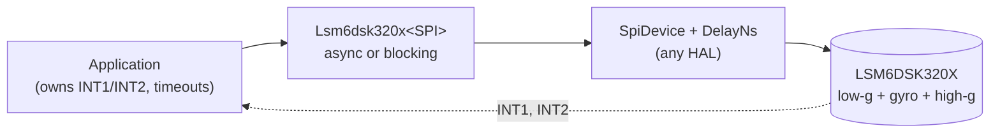

# lsm6dsk320x

Driver for the STMicroelectronics LSM6DSK320X, a six-axis IMU (gyroscope and low-g accelerometer) with a separate high-g accelerometer, over four-wire SPI. It is `no_std`, written against the `embedded-hal` 1.0 and `embedded-hal-async` 1.0 traits (optionally `defmt`), and owns no HAL, pin, timer or executor. The crate root is the async driver; `lsm6dsk320x::blocking` has the same methods for blocking buses. It was written for the MARV V2 Rev 1 flight controller (RP2354B). Version 0.1.0; the API may still change.



## Quick start

The settings structs are `#[non_exhaustive]`: build them with `Config::new().with_...`, a struct literal does not compile outside the crate. The scaffolding hidden below (a dummy SPI device and delay) is only there so that this example is compiled by `cargo test --doc`.

```rust,no_run
# use core::convert::Infallible;
# use embedded_hal::spi::{ErrorType, Operation};
# use embedded_hal_async::{delay::DelayNs, spi::SpiDevice};
# struct Spi;
# struct Delay;
# impl ErrorType for Spi {
#     type Error = Infallible;
# }
# impl SpiDevice for Spi {
#     async fn transaction(&mut self, _ops: &mut [Operation<'_, u8>]) -> Result<(), Infallible> {
#         Ok(())
#     }
# }
# impl DelayNs for Delay {
#     async fn delay_ns(&mut self, _ns: u32) {}
# }
# async fn run(spi: Spi, mut delay: Delay) -> Result<(), lsm6dsk320x::Error<Infallible>> {
use lsm6dsk320x::{
    AccelFullScale, BatchRate, Config, DataReady, FifoConfig, FifoFrame, FifoMode, GyroFullScale,
    HighGConfig, HighGFullScale, IntRouting, Lsm6dsk320x, Odr, fifo_frames,
};

let config = Config::new()
    .with_accel_fs(AccelFullScale::G4)
    .with_accel_odr(Odr::Hz960)
    .with_gyro_fs(GyroFullScale::Dps500)
    .with_gyro_odr(Odr::Hz960)
    .with_high_g(Some(HighGConfig::new().with_full_scale(HighGFullScale::G32)))
    .with_int1(IntRouting::new().with_data_ready(DataReady::new().with_accel(true)))
    .with_int2(IntRouting::new().with_fifo_threshold(true))
    .with_fifo(
        FifoConfig::new()
            .with_mode(FifoMode::Continuous)
            .with_watermark(32)
            .with_gyro(BatchRate::Hz960)
            .with_accel(BatchRate::Hz960),
    );

let mut imu = Lsm6dsk320x::new(spi);
let info = imu.init(&mut delay, &config).await?; // reset, identity check, configuration
let _gyro_rate_mhz = info.gyro_odr_mhz;

// Wait for the INT1 edge here (the application owns the pin). Put any timeout around this wait.
let raw = imu.read().await?; // gyroscope and low-g accelerometer, one transaction
let accel = raw.accel.accel_ms2(config.accel_fs); // m/s^2
let gyro = raw.gyro.gyro_rads(config.gyro_fs); // rad/s
let all = imu.read_all().await?; // temperature, gyroscope, low-g and high-g
let high_g = all.high_g.high_g_ms2(HighGFullScale::G32);
let celsius = all.temperature_c();

// FIFO: after the INT2 watermark edge, read into your own buffer, then decode it in place.
let mut buf = [0u8; 7 * 32];
let read = imu.fifo_read(&mut buf).await?;
for frame in fifo_frames(&buf[..read.bytes]) {
    if let FifoFrame::Gyro(sample) = frame {
        let _rate = sample.axes.gyro_rads(config.gyro_fs);
    }
}
# let _ = (accel, gyro, high_g, celsius);
# Ok(())
# }
# fn main() {}
```

Blocking: `lsm6dsk320x::blocking::Lsm6dsk320x::new(spi)` takes an `embedded_hal::spi::SpiDevice` and its methods are the same without `.await`, with an `embedded_hal` `DelayNs`.

## Docs

| Page | In one line |
|---|---|
| [docs/driver.md](docs/driver.md) | What the driver does, what the application provides, rules for correct use (start-up, data-ready timing), what is not covered |
| [docs/device.md](docs/device.md) | Registers, sensitivities, timing, pins, datasheet |
| [hil/README.md](hil/README.md) | On-board test programs and how to run them |

## Status

- Host tests (simulated bus, no hardware): `cargo test --locked`, plus the README doctest.
- On the board (MARV V2 Rev 1, SPI1): smoke, FIFO, calibration, self-test, cancel, modes, dual-channel, shock, data-ready lead and soak programs; see [hil](hil/README.md).
- Cargo feature `defmt` (off by default) adds `defmt::Format` to the public data and error types. Edition 2024.
- Not covered on purpose: the EIS channel, SFLP fusion, embedded functions, sensor hub, OIS, I2C/I3C, FIFO compression; see [driver](docs/driver.md).

## Used by

The MARV V2 flight-controller firmware ([MARV-FC](https://github.com/Lmx154/MARV-FC)) pins this crate.

## MARV project

| Repository | Role |
|---|---|
| [MARV-FC](https://github.com/Lmx154/MARV-FC) | Flight-controller firmware for the MARV V2 board (RP2350B) |
| [MARV-GCS](https://github.com/Lmx154/MARV-GCS) | Ground station (`marv-gcs`) and command line (`marv-cli`) |
| [MARV-sim](https://github.com/Lmx154/MARV-sim) | Simulator that runs the firmware's flight code |
| Sensors | [icm45686](https://github.com/Lmx154/icm45686-rs) · **lsm6dsk320x** · [bmp581](https://github.com/Lmx154/bmp581-rs) · [bmm350](https://github.com/Lmx154/bmm350-rs) · [sam-m10q](https://github.com/Lmx154/sam-m10q) · [adc-battery](https://github.com/Lmx154/adc-battery) |
| Board I/O | [pio-sdmmc](https://github.com/Lmx154/pio-sdmmc-rs) · [qmi-psram](https://github.com/Lmx154/qmi-psram-rs) · [ws2812c](https://github.com/Lmx154/ws2812c-rs) · [usb-cdc](https://github.com/Lmx154/usb-cdc) · [pio-uart](https://github.com/Lmx154/pio-uart) |
| Motors and links | [dshot](https://github.com/Lmx154/dshot-rs) · [esc-passthrough](https://github.com/Lmx154/esc-passthrough) · [rc-port](https://github.com/Lmx154/rc-port) · [crsf-codec](https://github.com/Lmx154/crsf-codec) · [mavlink-device](https://github.com/Lmx154/mavlink-device) · [marv-dialect](https://github.com/Lmx154/marv-dialect) |
| Other drivers | [lc76g](https://github.com/Lmx154/lc76g-rs) (Quectel LC76G GNSS) |

## License

MIT, see `LICENSE`. The driver is written from the datasheet listed in [docs/device.md](docs/device.md) (DS15060 Rev 1).
