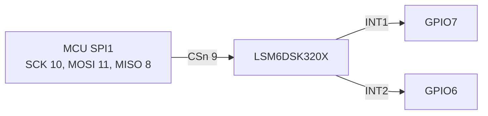

# LSM6DSK320X device facts

Part of [lsm6dsk320x](../README.md)

Register, sensitivity and board facts the driver was written against (MARV V2 Rev 1, IMU with high-g channel on SPI1). Page numbers are PDF pages of the datasheet linked at the end. Figures labelled observed were seen on the MARV V2 board.

## Bus

- SPI: first byte bit 7 = 1 for read (RW bit first, then AD6:0), modes 0 and 3, address auto-increment on by default (CTRL3 bit 2) (p22, p25, p67).
- WHO_AM_I 0x0F = 0x75 (p64).
- Outputs, little-endian 16-bit: temperature 0x20; gyro X 0x22, Y 0x24, Z 0x26; low-g accel X 0x28, Y 0x2A, Z 0x2C; high-g accel X 0x34, Y 0x36, Z 0x38 (p52-53, p78-84).

## Registers

| Register | Address | Fields |
|---|---|---|
| CTRL1 | 0x10 | bits 6:4 OP_MODE_XL (000 high performance); bits 3:0 ODR_XL (0101 = 60 Hz, 0110 = 120 Hz, 0111 = 240 Hz) (p65) |
| CTRL2 | 0x11 | same layout for the gyroscope (p66) |
| CTRL3 | 0x12 | bit 0 SW_RESET (self-clearing, about 230 us observed), bit 7 BOOT (p67); boot time not in the datasheet |
| CTRL4 | 0x13 | bit 1 DRDY_PULSED: 1 = data-ready pulses 65 us, 0 = latched until the high byte is read; device reset default 0; `Config::new()` selects pulsed (p68) |
| CTRL6 | 0x15 | bits 2:0 FS_G (001 = +-250, 010 = 500, 011 = 1000, 100 = 2000, 101 = 4000 dps); the reset value is a reserved code, so FS_G must be written; keep bit 3 as the datasheet requires (p69) |
| CTRL7 | 0x16 | bit 7 high-g data-ready on INT1, bit 6 on INT2 (p70) |
| CTRL8 | 0x17 | bits 1:0 FS_XL (00 = +-2 g, 01 = 4, 10 = 8, 11 = 16) (p71) |
| INT1_CTRL / INT2_CTRL | 0x0D / 0x0E | bit 0 low-g data-ready, bit 1 gyro data-ready (p63-64) |
| IF_CFG | 0x03 | bit 4 H_LACTIVE (0 = active high), bit 3 PP_OD (0 = push-pull), bit 2 SIM (0 = 4-wire), bit 0 I2C_I3C_disable; not reset by software reset (p58) |
| STATUS_REG | 0x1E | bit 0 XLDA, 1 GDA, 2 TDA, 3 XLHGDA, 4 GDA_EIS, 5 OIS_DRDY, 7 TIMESTAMP_ENDCOUNT (5.6 ms warning); the driver's `Status` decodes bits 0 to 3 (p77) |
| CTRL1_XL_HG | 0x4E | bit 7 XL_HG_REGOUT_EN, bit 6 HG_USR_OFF_ON_OUT, bits 5:3 ODR_XL_HG (011 = 480 Hz, 100 = 960 Hz), bits 2:0 FS_XL_HG (000 = +-32 g ... 100 = +-320 g) (p91); constants in `src/reg.rs` |

The high-g channel is allowed with any low-g ODR in high-performance mode; the lowest high-g ODR is 480 Hz (Table 21, p33).

## Sensitivity and conversion

| Channel | Full scale to sensitivity |
|---|---|
| Low-g (mg/LSB) | +-2 g 0.061, +-4 g 0.122, +-8 g 0.244, +-16 g 0.488 |
| High-g (mg/LSB) | +-32 g 0.976, +-64 g 1.952, +-128 g 3.904, +-256 g 7.808, +-320 g 10.417 |
| Gyro (mdps/LSB) | +-250 8.75, +-500 17.5, +-1000 35, +-2000 70, +-4000 140 |

Sensitivities from p12. Temperature: degC = raw/256 + 25 (p16).

## Timing

- Gyro turn-on is 40 ms typical, not guaranteed (Table 4, p15); clean samples were seen from about 65 ms; the driver waits 70 ms.
- ODR accuracy in normal high-performance mode is not specified (the +-1 % / +-3 % figures on p13 are for high-accuracy-ODR mode). At the 960 Hz setting the gyroscope ran at 942.66 Hz, 1.8 % below nominal, which the frequency-trim register INTERNAL_FREQ_FINE explains (rustdoc of `Info::gyro_odr_mhz`). In the high-accuracy ODR sets the rates were 957.66, 999.998, 800.664 and 833.998 Hz; the trim does not apply there.
- High-g zero-g offset: +-250 mg typical (Table 3, p12).
- High-g rate and FIFO words per second follow the selected high-accuracy ODR set like the low-g rate (within 0.5 % and 1 % of the measurement with low-g and gyroscope batched at 960 Hz; other batch rates in that mode are by analogy).

## Pins and bus (MARV V2)

All GPIO are 3.3 V logic and not 5 V tolerant.

| GPIO | Net | Function |
|---|---|---|
| 6 | IMU2_INT2 | GPIO input, INT2 |
| 7 | IMU2_INT1 | GPIO input, INT1 |
| 8 | IMU2_MISO | SPI1 RX |
| 9 | IMU2_CS | SPI1 hardware CSn, 10k pull-up R51 to V3V3_ANA |
| 10 | IMU2_SCK | SPI1 SCK |
| 11 | IMU2_MOSI | SPI1 TX |

The bus is 4-wire (SDx tied to V3V3_ANA, SCx to GND) with no pull resistors on clock or data. V3V3_ANA (sensors and their pull-ups) comes up after V3V3_SYS.

## Datasheet

LSM6DSK320X: https://www.st.com/resource/en/datasheet/lsm6dsk320x.pdf (DS15060 Rev 1)

## Related

[driver](driver.md) · [hil](../hil/README.md) · [README](../README.md)
