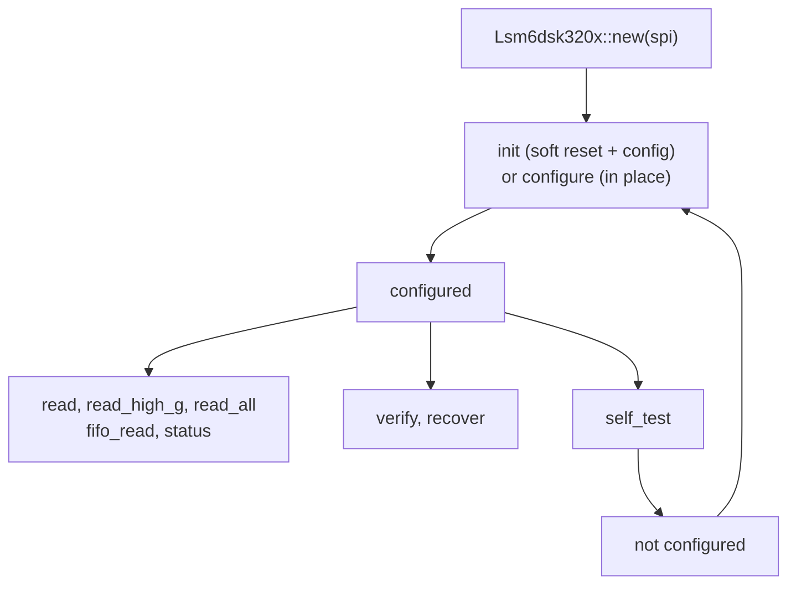

# Driver

Part of [lsm6dsk320x](../README.md)

What `Lsm6dsk320x<SPI>` offers, what the application must provide, and the rules that keep reads correct. Register facts are in [device](device.md); on-board checks are in [hil](../hil/README.md).

## What the application provides

| Item | Detail |
|---|---|
| SPI device | `embedded_hal_async::spi::SpiDevice` (async) or `embedded_hal::spi::SpiDevice` (blocking), chip select handled by the device; the chip supports modes 0 and 3 (p22) and up to 10 MHz (p17); the driver sets neither |
| `DelayNs` | for `init`, `configure`, `self_test` |
| INT1 / INT2 pins | the driver configures the chip's outputs (`Config::int1`, `int2`, `pins`) and never touches a pin. Data-ready is pulsed by default (`DataReadyMode::Pulsed`, 65 us per the datasheet; pulses of at least 51 us, 57 us average, were seen on the board); `Latched` holds it until the high byte of the output register is read |

## What the driver does

| Area | API |
|---|---|
| Settings | `Config`, checked by `Config::validate` before any bus access (`ConfigError` names the rule). Low-g `Odr` and `AccelFullScale` (+-2 to +-16 g); gyroscope `Odr` and `GyroFullScale` (+-250 to +-4000 dps), 7.5 Hz to 7.68 kHz; high-g `HighGConfig` (`HighGOdr` 480 Hz to 7.68 kHz, `HighGFullScale` +-32 to +-320 g); `OperatingMode::HighPerformance` or `HighAccuracyOdr(HaodrSet)` (four sets: 960, 1000, 800, 833 base); gyro LPF1, low-g LPF2 (ODR/4 to ODR/800), `drdy_mask`, `accel_fast_settling`, `DataReadyMode`, `PinConfig` |
| Setup | `init`, `configure`, `config`, `release`; the write plan is data (`Config::plan`, `plan::Plan`) |
| Reads | `read`, `read_high_g`, `read_all` (one transaction each), `status`; `RawAxes::accel_ms2`, `gyro_rads`, `high_g_ms2`, `RawAll::temperature_c` |
| FIFO | `FifoConfig`: modes, watermark, batch rates (gyro, low-g, high-g, temperature, timestamp), `stop_on_wtm`, `odr_change`. `fifo_read`, `fifo_read_exact`, `fifo_status`, `fifo_flush`; pure decoder `fifo_frames` over 7-byte tagged words (`Gyro`, `Accel`, `HighG`, `Temperature`, `Timestamp`, `ConfigChange`, `Unknown`, `Trailing`; never skips a byte); `fifo::timestamp_ns`, `timestamp_delta_ticks`, `fifo_words_per_second`; `FIFO_DEPTH_WORDS` is 256 (the datasheet says 1.5 KB) |
| Interrupts | `IntRouting` per pin: data-ready of each channel, FIFO threshold, overrun, full, high-g wake-up and shock (`HighGEvents`), timestamp overflow (INT2 only); `interrupt_status` reads the sources in 1 or 3 transactions |
| Counters, info | `stats` (FIFO overruns, words read, bus errors; never cleared); `info` (WHO_AM_I, trim `freq_fine`, output rates in mHz, expected FIFO words per second; in high-accuracy mode the table rate without trim) |
| Offsets | `set_offsets` with `calc::Offsets` (`OffsetWeight`), `offsets`; `init` clears, `configure` rewrites them. They act only when enabled: `Config::accel_offset` and `HighGConfig::user_offset` |
| Self-test | `self_test` with `SelfTestConfig` returns a `SelfTestReport` per channel and axis against the datasheet windows; about one second, configuration and offsets are re-applied afterwards, outputs and pins are not meaningful meanwhile. ST publishes no sequence for this part; the module docs say which steps follow the datasheet and which a sibling part |
| Health | `verify` (32 register reads, writes nothing, mismatch is `Error::ConfigMismatch`), `recover`, `verify_steps` / `verify_step(index)` to spread the check over time |
| Raw access | `read_register`, `read_registers`, `write_register`, register map in `reg`; they neither check nor change driver state |

## Rules for correct use

- Never cancel a bus transfer in flight: no timeout or `select` around a driver call that is on the bus; put the timeout around the wait for data-ready. On embassy-rp 0.10 a cancelled SPI transfer leaves stale bytes and the next read is wrong.
- After any doubt call `recover()`: it re-frames the bus, checks WHO_AM_I, then runs `verify()`.
- `read`, `read_high_g`, `read_all`, `status`, `interrupt_status`, the FIFO methods, `set_offsets`, `verify` and `self_test` return `Error::NotConfigured` until `init` or `configure` has completed; a failed or dropped `init`, `configure` or `self_test` leaves the driver not configured.
- Start-up: `init` and `configure` wait 70 ms after starting the gyroscope (`plan::GYRO_TURN_ON_US`); the datasheet's 40 ms is typical and not guaranteed, and gyroscope samples were clean from about 65 ms. No wait is added for the accelerometers. `Config::drdy_mask` (on by default) hides data-ready only for the settling the device knows about; with a 40 ms wait the first 4 gyroscope samples were off by up to 6.6 dps. A narrow low-g `accel_lpf2` settles slowly (ODR/100 at 240 Hz took 170 ms to come within 10 % of 1 g); `Config::accel_fast_settling` brought the first sample into band at 18 ms. Turn it on with a narrow LPF2, or discard samples.
- A data-ready flag stays set until the data is read, also across `configure` and when the sensor is off. Read once after `configure` and discard before relying on `status()` or `interrupt_status()` for a sensor you switched off or reconfigured.
- When a single-sample read is safe: the output registers change axis by axis between 22.25 us and 3.25 us before the INT1 data-ready edge (gyroscope X first, Y last; high-g axes at the same instants as low-g) and nothing changes after the edge. `BDU` keeps each 16-bit value whole but does not stop a read that overlaps the window from mixing axes of two samples, and nothing reports it: a read at a random phase was torn in about 7 % of reads. Start the read on the data-ready edge and finish at least 25 us before the next edge (at 7.68 kHz the period is about 132 us, so within about 105 us; `read_all` takes 32 to 44 us at 9.375 MHz). A task that can be delayed longer should read through the FIFO, where every set of words belongs to one sample. With the high-g channel at the same rate one data-ready edge times all three channels (INT2 follows INT1 by at most 0.55 us).
- High-g events: wake-up and shock flags are level flags; the shock flag reads true for about one sample (130 us), so a slower poll misses it; use the pin. Each strike gives a wake-up plus shock event when an axis passes the threshold and a second shock event about 80 ms later when the shock state ends.

## Timing and cost (observed on MARV V2 Rev 1, RP2354B at 150 MHz)

| Item | Value |
|---|---|
| `read()` (13 bytes on the wire), median | 25.1 us at 7.5 MHz and 22.1 us at 9.375 MHz in SPI mode 0; 23.0 us and 21.0 us in mode 3 |
| SPI burst cost (PL022) | 9.5 bit times per byte in mode 0, 8.0 in mode 3 (mode 3 saves about 16 %) |
| Driver CPU on top of the bare HAL | 0.84 us `read()`, 0.87 us `read_all()`, 1.2 us for a 28-word FIFO read |
| `fifo_frames` decode | 0.83 us per FIFO word |
| High-accuracy ODR sets 960 / 1000 / 800 / 833 | 957.66, 999.998, 800.664, 833.998 Hz |
| Normal mode at the 960 Hz setting | 942.66 Hz (frequency trim) |
| High-g zero offset against low-g at rest | about 0.05 / -0.15 / 0.30 g on X / Y / Z at every full scale; calibrate with the high-g offset registers |

## Not covered

The gyroscope EIS channel, ODR-triggered mode, SFLP sensor fusion, low-power and normal operating modes, embedded functions (FSM, MLC, tap, free-fall, pedometer), sensor hub, OIS, I2C and I3C (`init` disables them in IF_CFG, SPI only), FIFO compression and the accelerometer high-pass filter. There is no method to reload the factory trimming (BOOT). The only FIFO trigger is the high-g wake-up, and `Config::validate` rejects a triggered mode without it.

Present but not exercised on the real sensor (host tests cover them on a simulated bus): `HighGWakeUpMode::OnChange`, wake-up thresholds other than 0 g and 3 g, shock duration codes other than 0, the shock generator at high-g full scales other than +-64 g, FIFO modes other than `Continuous`, `stop_on_wtm`, routing FIFO full, overrun or timestamp overflow to a pin, and gyroscope full scales +-1000, +-2000, +-4000 dps and low-g +-8, +-16 g.

## Code

| Path | Contents |
|---|---|
| `src/lib.rs` | `Lsm6dsk320x`, `Error`, `Info` |
| `src/config.rs`, `src/plan.rs` | settings and register write plan |
| `src/reg.rs`, `src/image.rs` | register map and image |
| `src/data.rs`, `src/sample.rs`, `src/calc.rs` | reads, conversions, offsets and self-test windows |
| `src/fifo.rs`, `src/selftest.rs`, `src/blocking.rs` | FIFO, self-test, blocking front-end |

## Related

[device](device.md) · [hil](../hil/README.md) · [README](../README.md)
